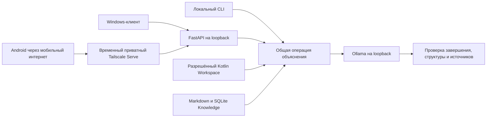

# Week 6 — технический итог Days 26–30

Финализация 11 октября 2026, Windows. Пользователь принял неделю без дальнейших
экспериментов. Day 30: **IMPLEMENTED — ACCEPTED WITH KNOWN LIMITATION**.
Это завершение учебного этапа, а не утверждение о полной приёмке каждого критерия.

## Что реализовано и принято

| День | Реализация и наблюдения | OpenSpec при финализации |
|---|---|---|
| [26](../day-26-local-llm/README.md) | Установка Ollama, локальная Qwen через CLI/HTTP, первые Kotlin/Android-вопросы; подтверждение пользователя. Отдельного кода или численного протокола нет. | skipped: change отсутствует |
| [27](../day-27-local-architecture-assistant/README.md) | Самостоятельный CLI, ограниченный Kotlin Workspace, JSON и проверка строк. Один Windows-запуск технически успешен, смысловая оценка PARTIAL. | 11/11, archived; 8 требований синхронизированы в main spec |
| [28](../day-28-local-architecture-rag/README.md) | Markdown Knowledge, SQLite, локальные embeddings, FTS5/vector, актуальность индекса и цитаты. Улучшение качества от RAG не подтверждено: A/B не завершён. | 26/28, active; 5.5 и 5.7 открыты |
| [29](../day-29-local-assistant-optimization/README.md) | Qwen3 4B и Coder 7B, измерения, ограниченные эксперименты prompts/schema. **NO SUITABLE PROFILE CONFIRMED**. | 23/33, active; 5.2–5.10 и 6.1 открыты |
| [30](README.md) | Необязательный HTTP-сервис и клиент; offline и локальная техническая приёмка; приватный HTTPS с телефона. Доставка второго ответа в финальной remote-паре не подтверждена. | 31/33, active; 7.1 и 7.2 открыты |

Mac M1 фактически не проверен. Принятие ограничений пользователем не закрывает
непроведённые проверки. Исторические отчёты, неудачи и незавершённые задачи сохранены.

## Архитектура

CLI и FastAPI используют один runtime в каталоге Day 27. В Day 28 добавлены
индексация и поиск; в Day 29 — явные opt-in настройки экспериментов; в Day 30 —
общая операция объяснения, клиентская история и безопасные категории ошибок.
Второй RAG, отдельный агент, MCP, серверная история и отдельная векторная БД не созданы.



Схема показывает проверенный маршрут демонстрации; сейчас Serve и FastAPI выключены.
CLI не требует FastAPI. Установка и запуск описаны в
[общем CLI](../day-27-local-architecture-assistant/README.md) и
[HTTP-компоненте](laa_service/README.md).

HTTP-контракт: публичный минимальный `GET /healthz`; авторизованные `GET /readyz`,
`GET /v1/status`, `POST /v1/chat`. Клиент передаёт `file_id`, вопрос и до двух
предыдущих пар, максимум 8 KiB истории. Пути выбирает владелец сервера.
Каждый ход повторно читает текущие разрешённые источники. Поисковый запрос учитывает
текущий и последний пользовательский вопрос и имя Kotlin; прежний ответ модели
не становится доказательством. История не сохраняется сервером.

Bearer auth, ограничения тела/контекста, rate limit, два допуска и безопасные
ошибки обеспечиваются кодом. Логи ограничены безопасными метаданными; HTTPX/HTTPCore
и access logs не выводят произвольные URL, заголовки или содержимое. Синхронная
операция вынесена из event loop, поэтому health остаётся доступен. Своя очередь
не создана: используется штатная Ollama с `parallel=1`. Тайм-аут клиента не
считается остановкой inference; при неопределённости действует `recovery_required`.

## Проверки финализации — без модели

| Проверка | Результат |
|---|---|
| Полный текущий runtime + Day 29 + HTTP tests | **415 passed / 1 skipped**, 7,63 с |
| CLI-only окружение, FastAPI отсутствует | **349 passed / 1 skipped**, 4,78 с |
| Отдельный снимок Git index Day 27 | **101 passed / 1 skipped**, 0,55 с |
| Отдельный снимок Git index Day 28 | **222 passed / 1 skipped**, 4,07 с |
| Отдельный снимок Git index Day 29 | **349 passed / 1 skipped**, 4,89 с |
| Python syntax | 41 файл: AST и compile без записи bytecode; staged snapshots также проверены |
| OpenSpec | Все четыре changes валидны перед архивом; финальное `validate --all --strict --no-interactive`: **50 passed, 0 failed** |
| Документация и Git | 124 относительные файловые ссылки, индекс Days 26–30, diff whitespace и staged scope — PASS |

Skip относится к FIFO на Windows. Единственное предупреждение полного прогона —
Starlette о будущем изменении интеграции TestClient с HTTPX; тесты прошли.
Первая CLI-only команда ошибочно выполнялась из корня и завершилась ошибками
импорта при сборе тестов. Запуск из документированного каталога утилиты прошёл;
производственный код для этого не менялся.

Полный прогон включает настоящий loopback TCP с fake Ollama: два клиента получают
отдельные ответы, третий — 503; проверяются здоровье, тайм-ауты, recovery, история,
источники, auth и logging. Это не новое измерение реальной модели.

Воспроизводимая команда из корня после установки dev-зависимостей:

```powershell
Push-Location day-27-local-architecture-assistant
& ../day-30-private-assistant-service/.venv/Scripts/python.exe -B -m pytest tests ../day-29-local-assistant-optimization/tests ../day-30-private-assistant-service/tests -q -p no:cacheprovider
Pop-Location
```

## Сохранённая live-приёмка Day 30

| Проверка | Технический результат | Смысл и границы вывода |
|---|---|---|
| [Первый диалог](../openspec/changes/day-30-private-assistant-service/live-dialogue-2026-10-11.md) | 2/2 HTTP 200, done/stop, mechanical PASS; 13,05 / 10,90 с | PARTIAL / FAIL: уточнение почти повторило ответ, хотя история передана |
| [Первая локальная пара](../openspec/changes/day-30-private-assistant-service/live-concurrent-2026-10-11.md) | Два допуска, max_active=2, health PASS; 200 / 502 (`length`) | Первый PARTIAL; второй технически не принят. Исходный FAIL сохранён |
| [Узкая локальная пара](../openspec/changes/day-30-private-assistant-service/live-concurrent-additional-2026-10-11.md) | 2/2 HTTP 200, done/stop, mechanical PASS; 12,08 / 22,90 с | Предварительно FAIL / PARTIAL; технический критерий 6.3 закрыт только по этой паре |
| [Windows + Android](../openspec/changes/day-30-private-assistant-service/live-remote-2026-10-11.md) | Два допуска, max_active=2, health 200 за 1,23 мс; Windows 200 за 11,98 с | Android disconnect примерно через 10 с; телефон сообщил 503 дополнительной HTTP-попытки. Два клиентских успеха NOT CONFIRMED |

Android через мобильный интернет с выключенным Wi-Fi подтвердил HTTPS health
без предупреждения TLS и авторизованный readiness `ready=true`. Это отдельные
успешные проверки сети и авторизации, не подтверждение качества модели.

В финальной паре обе внутренние операции Ollama завершились done/stop и прошли
механическую проверку; последняя завершилась через 22,61 с. Всего наблюдались три
HTTP-попытки, два допуска и две генерации. Дополнительный 503 связан с защитой
временного ограниченного сценария; его нельзя выдавать за новую проверку штатной
перегрузки. Причина отключения/дополнительной попытки не установлена. Время очереди
отдельно не измерено; HTTP concurrency не доказывает параллельное GPU inference.

Открытые 7.1: удалённые отрицательные проверки доступа к Ollama/каталогам и review
tailnet policy. Открытые 7.2: два успешных клиентских завершения. Windows и Android
не равнозначны двум успешным чатам только потому, что оба inference завершены.

Прежний потолок Day 30 был 6 generations, затем явно расширен до 8. Фактический
расход **8/8**: диалог 2, первая пара 2, узкая пара 2, remote 2. При финализации
**0 новых generations, 0 embeddings**, бюджет не расширялся. Счёт Day 29 — отдельные
14/32 load/chat attempts; их нельзя смешивать с бюджетом Day 30.

## Git и операции завершения

Репозиторий: [Normalnick12/ai-advent-9](https://github.com/Normalnick12/ai-advent-9),
ветка `main`, upstream `origin/main`. Коммиты оформлены при финализации, без
изменения дат: они разделяют существующие изменения по дням и зависимостям,
а не изображают коммиты, будто созданные в дни экспериментов. Рабочие исходники
сохранены; частичные версии для staging проверены в отдельных игнорируемых снимках.

| День | Commit |
|---|---|
| 26 | `49e3211cc2f4ece31cd4cde43243f079c7333b25` — Complete Day 26 local LLM setup and findings |
| 27 | `f2702ca732cdf79de2971a9adf1bd5a8deaa612f` — Complete Day 27 local architecture assistant |
| 28 | `7a3ef2d9985988ba4700d7072de45664524e4022` — Complete Day 28 local knowledge and RAG |
| 29 | `22e77eeabb453d02a60fffc22bba40a192876f91` — Complete Day 29 local model experiments and findings |
| 30 | Commit, содержащий этот отчёт: Complete Day 30 private local assistant service |

SHA Day 30 нельзя вписать в собственное содержимое до создания commit. Его точное
значение и итог push приведены в сообщении финализации; получить все пять локально:
`git log --reverse --format="%H %s" 69c1495..HEAD`.

Day 27 перенесён в
[архив](../openspec/changes/archive/2026-10-11-day-27-local-architecture-assistant/verification.md)
с синхронизированным [main spec](../openspec/specs/local-architecture-assistant/spec.md).
Days 28–30 намеренно не архивированы. Их исходные evidence, manifests, hashes
и task checkboxes не переписывались; старые пути в исторических hash-manifests
описывают состояние на дату измерения, до архивирования Day 27.

Сверка 891 исходного файла показала изменения только четырёх README; шесть файлов
Day 27 перемещены в архив с идентичными байтами. Исходники runtime, Weeks 1–5 и
историческое evidence не изменены при финализации.

Секреты и локальные данные проверены отдельно от кода. `.local`, DPAPI, окружения,
SQLite-кэши и Python caches исключены из staging. Проверка известных шаблонов
ключей дополняет просмотр состава; внешний secret scanner не установлен.
Известный действующий локальный токен также проверен на отсутствие во всём
финальном Week 6 index без вывода его значения; файл временного телефонного токена отсутствует.
Новые отчёты содержат только синтетические результаты и безопасные метаданные.

Serve и HTTP уже выключены, телефонный токен отозван по предыдущему cleanup.
Во время финализации сеть и Ollama не перенастраивались. Не выполнялись новые
benchmarks, исправления модели, Mac-проверки или запись видео. Видео остаётся
внешним артефактом пользователя.
